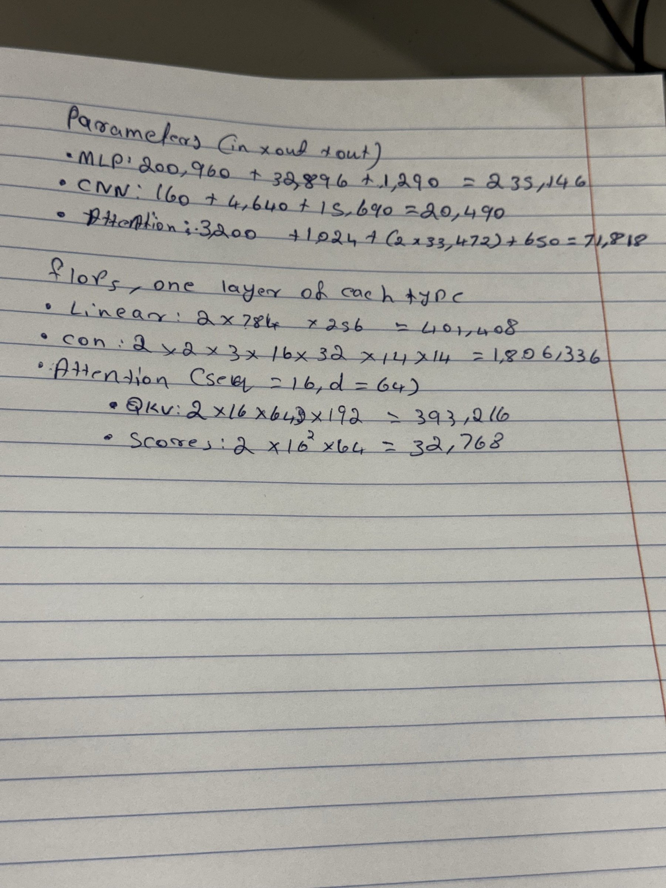

# Lab 3 — Architectures and Their Costs

## Goal

Compare three neural network architectures (MLP, CNN, attention) on
Fashion-MNIST. For each one I measured the parameter count, FLOPs
(calculated by hand and checked with thop), CPU inference latency and
test accuracy. Then I decided which architecture is the most
cost-effective.

## Method

### Dataset

- Dataset: Fashion-MNIST from `torchvision.datasets.FashionMNIST`.
- Transform: `ToTensor()` and `Normalize((0.2860,), (0.3530,))`.
- Split: the official 60k training set was split into 55,000 training
  and 5,000 validation images with `random_split` and seed 42.
- Test: the official 10,000-image test set.
- Batch size: 128.
- Seeds: `random`, `numpy` and `torch` were all set to 42.

### Models

- **MLP:** Flatten 784 → Linear 256 → ReLU → Linear 128 → ReLU → Linear 10.
- **CNN:** Conv2d(1,16,3,p=1) → ReLU → MaxPool2 → Conv2d(16,32,3,p=1)
  → ReLU → MaxPool2 → Flatten → Linear(1568, 10).
- **Attention:** the 28×28 image is split into 16 patches of 7×7. Each
  patch goes through Linear 49 → 64 and gets a learned position
  embedding. Then there are two Transformer encoder layers
  (d_model=64, nhead=4, dim_feedforward=128, dropout 0), a mean pool
  over the 16 tokens, and Linear 64 → 10.

The position embedding is my addition. The lab sheet does not mention
one, but without it the model cannot tell where each patch came from.

### Cost measurement

- Parameters were counted with `torchinfo.summary`. The full summaries
  are in `results/torchinfo_summaries.txt`.
- FLOPs for one image were calculated by hand with the Chapter 4
  formulas. A Linear layer is `2 × in × out` and a Conv2d layer is
  `2 × K × K × C_in × C_out × H_out × W_out`. These counts include only
  the weight multiply-adds, not bias, ReLU, pooling, softmax or
  LayerNorm.
- The hand counts were compared with `thop.profile`. thop reports MACs,
  so I multiplied them by 2 to get FLOPs.
- Latency was measured on the CPU (8 threads) with the trained models
  in `eval()` and `inference_mode()`, after 5 warm-up runs. For batch 1
  I report the median of 100 runs, and for batch 128 the median of 20
  runs.

### Training

All three models were trained for 5 epochs with Adam (lr = 1e-3,
batch 128) and cross-entropy loss, on the CPU.

## Results

### Summary

| Model | Parameters | Hand FLOPs | thop FLOPs (2×MACs) | Batch 1 latency (ms) | Batch 128 latency (ms) | Test accuracy |
|---|---:|---:|---:|---:|---:|---:|
| MLP | 235,146 | 469,504 | 469,504 | 0.032 | 0.164 | 0.8790 |
| CNN | 20,490 | 2,063,488 | 2,063,488 | 0.128 | 8.166 | **0.8954** |
| Attention | 71,818 | 2,329,856 | 101,632 | 0.404 | 10.031 | 0.8571 |

**Note on model size:** the lab asks for 100k–150k parameters, but the
exact layer sizes given in the sheet produce 235k (MLP), 20k (CNN) and
72k (attention). I kept the sheet's layer definitions, so the models
are not the same size. This matters for the comparison: the CNN has
11× fewer parameters than the MLP but still has the highest accuracy.

### Hand-calculated FLOPs, one layer of each type

| Layer | Formula | FLOPs |
|---|---|---:|
| MLP fc1 (784 → 256) | 2 × 784 × 256 | 401,408 |
| CNN conv2 (3×3, 16 → 32, 14×14 output) | 2 × 3 × 3 × 16 × 32 × 14 × 14 | 1,806,336 |
| Attention: QKV projections | 2 × 16 × 64 × 3 × 64 | 393,216 |
| Attention: scores QKᵀ | 2 × 16² × 64 | 32,768 |
| Attention: scores × V | 2 × 16² × 64 | 32,768 |
| Attention: output projection | 2 × 16 × 64 × 64 | 131,072 |
| Attention: feed-forward 64 → 128 → 64 | 2 × 16 × 64 × 128 × 2 | 524,288 |
| **One encoder layer, total** | | **1,114,112** |

The per-layer values for all layers are in
`results/hand_flops_per_layer.csv`.

My handwritten pen-and-paper calculations of the parameter counts and
one-layer FLOPs are in `results/hand_calculations.jpg`.

### Hand count vs thop

- **MLP and CNN:** the hand count and thop agree exactly. thop counts
  one MAC per weight multiply in Linear and Conv2d layers, which is the
  same thing the Chapter 4 formulas count. The only difference is that
  thop reports MACs, so its number has to be multiplied by 2.
- **Attention:** thop reports only 101,632 FLOPs, about 4% of the hand
  count. That number is just the patch projection plus the classifier
  head. Both encoder layers are counted as zero, for three reasons:
  1. `thop.profile` puts the model in `eval()` mode and runs it without
     gradients. In that mode PyTorch runs `TransformerEncoderLayer`
     through a single fused kernel (the "fast path"), so the forward
     hooks on the inner Linear layers never run. I checked this by
     adding a hook to `linear1`: it fired in train mode but not in eval
     mode with `no_grad`.
  2. thop has no counting rule for `nn.MultiheadAttention`, so it
     records 0 for it.
  3. The QKᵀ and softmax × V matrix multiplications are function calls
     inside attention, not modules, so a hook-based profiler cannot see
     them even in train mode.

  This means profilers that work through module hooks can badly
  undercount transformer models. For attention, the hand calculation
  is the more reliable number.

### Training curves (validation accuracy)

| Epoch | MLP | CNN | Attention |
|---:|---:|---:|---:|
| 1 | 0.8468 | 0.8652 | 0.8032 |
| 2 | 0.8604 | 0.8828 | 0.8362 |
| 3 | 0.8680 | 0.8874 | 0.8498 |
| 4 | 0.8804 | 0.8948 | 0.8476 |
| 5 | 0.8836 | 0.8974 | 0.8616 |

One training epoch took about 3.7 s for the MLP, 16.7 s for the CNN and
9.5 s for the attention model on the CPU (`results/training_history.csv`).

### Plots

- `results/accuracy_vs_params.png`: test accuracy vs parameter count.
- `results/accuracy_vs_latency.png`: test accuracy vs batch 1 and
  batch 128 latency.

## Discussion: access patterns and cost-effectiveness

**MLP.** Every weight is used only once per image, so at batch 1 the
MLP is limited by memory: it has to read about 0.94 MB of fp32 weights
to do only 0.47 MFLOP. With batch 128 the same weights are reused for
128 images in one large matrix multiply (GEMM). The time per image then
drops from 0.032 ms to 0.0013 ms, which is 25× faster. Dense GEMM is
the operation CPUs run best.

**CNN.** The CNN has very few weights (20k), and each one is reused at
every spatial position. That weight sharing is why it gets the best
accuracy with the fewest parameters. On the other hand, it does 4.4×
more FLOPs than the MLP, and on the CPU the convolution has to be
rearranged into a matrix first (im2col), which creates large temporary
activations. So batching helps the CNN much less than the MLP: the time
per image only goes from 0.128 ms to 0.064 ms.

**Attention.** The attention model does about the same number of FLOPs
as the CNN, but they are split across many small operations: QKV
projections, a 16×16 score matrix per head, softmax, LayerNorm,
reshapes and the feed-forward layers. With only 16 tokens and
d_model = 64 these matrix multiplies are too small to use the CPU well,
and the time goes into launching operations and moving data between
them. That makes it the slowest model at both batch sizes. It also has
less built-in knowledge about images than the CNN (no locality or
weight sharing inside patches), so after 5 epochs it has the lowest
accuracy.

**Most cost-effective: the CNN.** It has the highest test accuracy
(89.5%), the fewest parameters (20k, so the smallest model in storage
and memory) and still runs a single image in 0.13 ms. If the goal were
only maximum throughput on a CPU for large batches, the MLP would win
(0.16 ms for 128 images), but it gives up 1.6 accuracy points and needs
11× more parameters. The attention model is the worst choice for this
dataset: it is slower and less accurate than the CNN.

## Conclusions

1. Parameter count and FLOPs measure different costs. The CNN has the
   fewest parameters but more than 4× the FLOPs of the MLP, while the
   MLP has the most parameters but is the fastest to run. Neither
   number predicts latency on its own: how the weights and activations
   are accessed decides the actual speed.
2. Profiling tools need to be checked against a hand calculation. thop
   matched exactly for the Linear and Conv layers, but missed about 96%
   of the attention model's FLOPs because of the fused fast path and
   the matrix multiplies inside attention.
3. On small images, a CNN's built-in assumptions (locality and weight
   sharing) pay off. It reached the best accuracy with the smallest
   model. The small attention model needs more data or more epochs
   before it can make up for not having those assumptions.

## Reproducing

Run `lab01/src/print_versions.py` (output saved to
`results/versions.txt`), then `lab03/src/architectures.py`. The data is downloaded to `data/` at the repo root (git-ignored).

## Outputs

- `results/final_results.csv`
- `results/model_costs.csv`
- `results/flops_comparison.csv`
- `results/hand_flops_per_layer.csv`
- `results/hand_calculations.jpg`
- `results/latency_results.csv`
- `results/training_history.csv`
- `results/torchinfo_summaries.txt`
- `results/accuracy_vs_params.png`
- `results/accuracy_vs_latency.png`
- `results/versions.txt`
